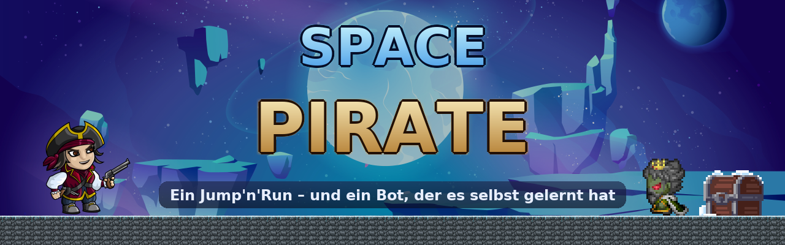
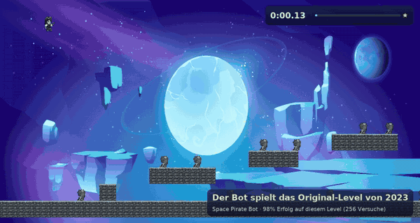
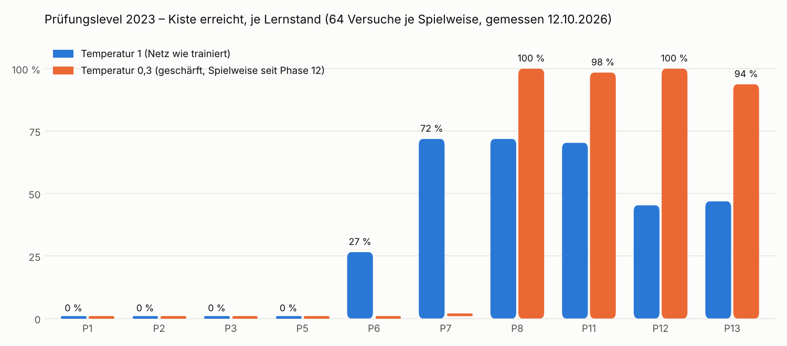
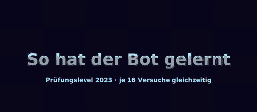
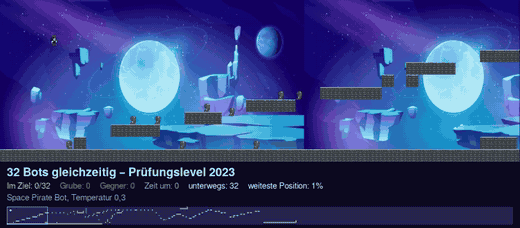

<p align="center">
  
</p>

<p align="center">
  
  
  
  
  
  
</p>

**Space Pirate** ist ein 2D-Jump'n'Run aus dem Jahr 2023: Ein Weltraumpirat springt über Lücken, stompt oder
erschießt Gegner und sucht die Schatzkiste. 2026 wurde das Spiel neu aufgebaut, und **ein Bot hat es per
Reinforcement Learning selbst gelernt**. Heute ist daraus eine fertige Spiel-App geworden, mit Rennen gegen den Bot,
Bestzeiten und einem Level-Editor, der beweist, ob der Bot ein Level schaffen kann.

<p align="center">
  <br>
  <sub>Der trainierte Bot spielt das <b>Original-Level von 2023</b>, auf dem er nie trainiert hat (Zeitraffer 3×).
  <a href="docs/medien/bot_pruefung_2023.mp4">Ganzer Lauf in Echtzeit (MP4)</a></sub>
</p>

## Was drin steckt

| Bereich | Was es kann |
|---|---|
| 🎮 **Spiel-App** | Ladescreen, Menü, 57 Level in fünf Reitern plus endlose Zufallslevel, Bestzeiten, 1–3 Sterne, Bestzeit-Geist, synthetisierte Musik → [Spielen](docs/spielen.md) |
| 🤖 **Gegen den Bot** | Wettrennen gegen das trainierte Netz, das als Geist im selben Level läuft; der Vorsprung ist der Schwierigkeitsregler → [Spielen](docs/spielen.md#gegen-den-bot) |
| 🧱 **Level-Editor** | mit der Maus bauen, alte Level umbauen; „Prüfen“ sucht im Hintergrund einen echten Bot-Weg und markiert, bis wohin er bewiesen ist → [Editor](docs/level_editor.md) |
| 🧠 **Lernender Bot** | PPO mit kleinem CNN, Nachahmen des Lösers, Curriculum über 14 Generator-Stufen; 98 % auf dem Prüfungslevel → [Der Bot](docs/bot.md) |
| 📓 **Lerntagebuch** | 13 Phasen in 14 Kapiteln, mit Fehlschlägen und ehrlichen Messungen, dazu ein interaktives Notebook → [Lerntagebuch](docs/lernen/00_ueberblick.md) |

## Schnellstart

```bash
pip install -r requirements.txt     # pygame, numpy, PyTorch (CPU genügt), stable-baselines3, …
python spacepirate.py               # die App starten
```

Steuerung: `A`/`D` laufen, `W`/Leertaste springen, Enter schießen, Esc Pause, F11 Vollbild.
Weitere Startwege, etwa `python game.py <level.txt>` oder `python leveleditor.py`, stehen in [docs/spielen.md](docs/spielen.md).

## Der Bot in Zahlen

| Messung (Level, die er **nie** trainiert hat) | Ergebnis |
|---|---|
| Original-Prüfungslevel von 2023 (256 Versuche) | **98 %** |
| Generalist-Wert: 8 Level-Kategorien, frische Seeds | **87 %** |
| Gabeln & Sackgassen · Kanäle · lange Level | 90 % · 95 % · 82 % |
| Links / gespiegelte Level (größte offene Lücke) | 52 % |

<p align="center">
  
</p>

<table>
  <tr>
    <td width="50%"><br>
      <sub><b>So hat er gelernt:</b> je 16 Bots pro Lernstand, Phase 1 bis 13 (<a href="docs/medien/bot_lernfortschritt.mp4">MP4</a>)</sub></td>
    <td width="50%"><br>
      <sub><b>32 Bots gleichzeitig</b> auf dem Prüfungslevel (Geister-Ansicht)</sub></td>
  </tr>
</table>

Wie die Zahlen entstehen und was der Bot sieht, steht in [docs/bot.md](docs/bot.md). Die Lernkurve ist nachmessbar
mit `scripts/make_readme_media.py measure`.

## Die App

<p align="center">
  
</p>

## Dokumentation

| Seite | Inhalt |
|---|---|
| [Spielen](docs/spielen.md) | Modi, Steuerung, Sterne, Geist, Bot-Rennen, Einstellungen, Spielstand |
| [Level & Editor](docs/level_editor.md) | Level-Format, Ordner, Editor, bewiesener Weg, Löser und Generator auf der Kommandozeile |
| [Der Bot](docs/bot.md) | Beobachtung, Aktionen, Netz, Belohnung, Messwerte, Modelle, Zuschauen |
| [Training](docs/training.md) | Trainings- und Auswertungsbefehle aller Phasen, Medien neu erzeugen |
| [Architektur](docs/architektur.md) | Pakete, Diagramm, warum alles deterministisch ist, Tests |
| [Lerntagebuch](docs/lernen/00_ueberblick.md) | von „Was ist Reinforcement Learning?“ bis Phase 13 |

## Projektstruktur

```
spacepirate.py · game.py · leveleditor.py   Startpunkte: App, ein Level direkt, Editor
jumpnrun/core/        deterministischer Spielkern (ohne Grafik, ohne Uhr)
jumpnrun/render/      Grafik, Geister-Ansicht, Video-Export
jumpnrun/levelgen/    Level-Generator, Löser, Weg-Karte
jumpnrun/rl/          Gymnasium-Umgebung, Netz, Training, Messungen
jumpnrun/imitation/   Musterlösungen, Behavior Cloning, DAgger
jumpnrun/editor/      Level-Editor mit bewiesenem Weg
jumpnrun/app/         Spiel-App: Szenen, Spielstand, Bot-Gegner, Klang
levels/ · models/     Level-Dateien · trainierte Bots aller Phasen
docs/ · tests/        Dokumentation, Lerntagebuch · rund 170 Tests
legacy/               der frühere RL-Versuch (2025/26), unverändert
```

## Geschichte

- **2023:** Leon schreibt Space Pirate als pygame-Projekt: Pirat, Gegner, Kiste und ein langes Level, das heute
  das **Prüfungslevel** ist ([UML von damals](UML/UML_Diagramm.png)).
- **2025/26:** ein erster RL-Versuch mit Checkpoint-Belohnungen (Autor „MararatscherCode“). Er liegt unverändert in [`legacy/`](legacy/README.md).
- **2026:** Neubau mit deterministischem Spielkern. Ein Löser beweist, dass Level lösbar sind. Der PPO-Bot lernt in
  13 Phasen vom ersten Sprung bis zum Generalisten. Danach entstehen der Level-Editor und die Spiel-App.

## Credits & Lizenz

Code: [MIT](LICENSE) © 2023–2026 Leon von Detten. Die Grafiken sind freie Assets mit eigenen Lizenzen:
Pirat von [Craftpix](https://craftpix.net/freebies/free-2d-pirate-character-sprites/),
Gegner von [Pipoya](https://pipoya.itch.io/pipoya-free-rpg-character-sprites-32x32),
Blöcke von [PNG Wing](https://www.pngwing.com/en/free-png-zoola/download),
Kiste von [Admurin](https://admurin.itch.io/free-chest-animations).
Musik und Effekte werden im Spiel per Code erzeugt.
