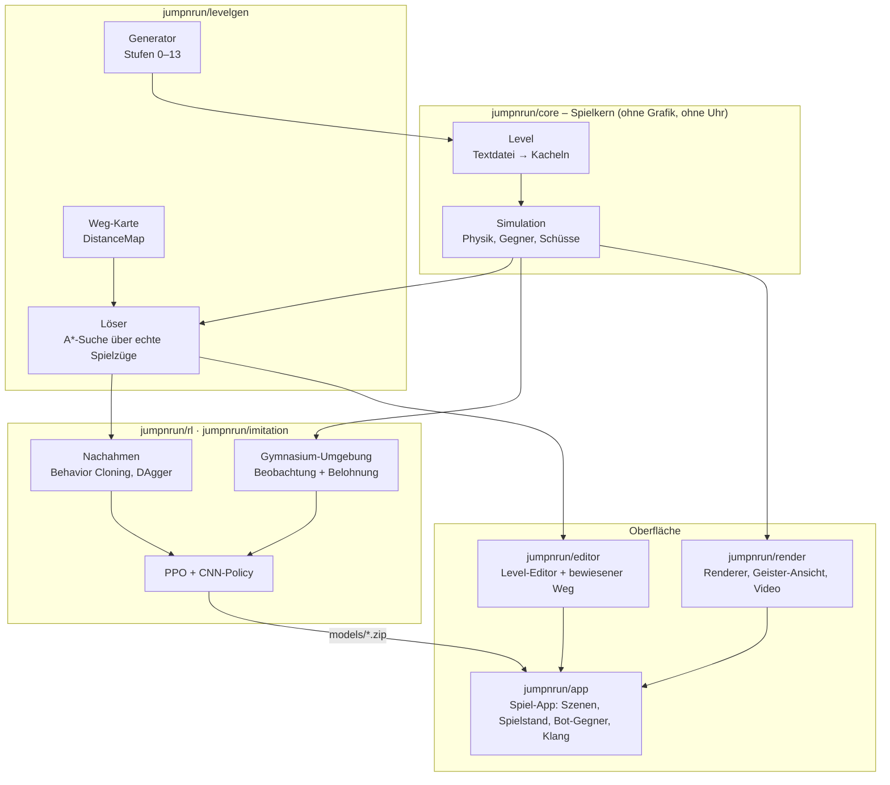

# Architektur

[← zurück zur README](../README.md)

Alles baut auf einem kleinen, **deterministischen Spielkern** auf. Mensch, Bot, Löser, Editor und App spielen
exakt dieselbe Simulation. Grafik, Klang und Uhr sitzen nur außen herum.



## Die Bausteine

| Paket | Aufgabe | Wichtigste Dateien |
|---|---|---|
| `jumpnrun/core` | Level laden, Physik (30 Frames/s, feste Ganzzahl-Schritte), Gegner, Schüsse, Sieg/Tod | `level.py`, `sim.py`, `entities.py`, `actions.py` |
| `jumpnrun/render` | zeichnet eine Simulation; die Geister-Ansicht zeigt viele Bots auf einmal; Video-Export ohne Bildschirm | `renderer.py`, `ghosts.py`, `video.py` |
| `jumpnrun/levelgen` | Level-Generator (14 Stufen), Löser (Beweis der Lösbarkeit), Weg-Karte, Fähigkeits-Proben | `generator.py`, `solver.py`, `distmap.py` |
| `jumpnrun/rl` | Gymnasium-Umgebung, Netz, Curriculum, PPO-Training, Messungen | `env.py`, `policy.py`, `train.py`, `modelinfo.py` |
| `jumpnrun/imitation` | Musterlösungen vom Löser, Behavior Cloning, DAgger | `demos.py`, `bc.py` |
| `jumpnrun/editor` | Raster-Modell (byte-genaues Speichern), bewiesener Weg mit Hintergrundsuche, Oberfläche | `model.py`, `proof.py`, `app.py` |
| `jumpnrun/app` | die Spiel-App: Szenenstapel, Levelindex, Spielstand, Bot-Gegner, synthetisierter Klang | `main.py`, `scenes.py`, `bot.py`, `audio.py` |
| `jumpnrun/ui` | gemeinsame Bedienelemente (Theme, Knöpfe, Dialoge) | `widgets.py` |
| `legacy/` | der frühere RL-Versuch (2025/26) und das alte Spiel, unverändert aufbewahrt | `README.md` |

## Warum deterministisch?

Die Simulation kennt keine Uhr und keinen Zufall. Gleiche Eingaben ergeben immer dasselbe Spiel. Darauf beruhen
viele Teile des Projekts:

- **Training:** Spielzeit ist billig, etwa 19.000 Frames pro Sekunde und CPU-Kern. Ein Versuch lässt sich exakt
  wiederholen.
- **Löser und Editor:** Eine gefundene Aktionsliste ist ein **Beweis** der Lösbarkeit. Der Editor erkennt durch
  Nachspielen und Vergleichen aller Zustände genau, ab wo eine Änderung einen Weg bricht.
- **App:** Der Bestzeit-Geist ist nur die gespeicherte Eingabefolge, also ein Hex-Zeichen pro Frame, und läuft
  exakt nach.
- **Tests:** Sie prüfen zum Beispiel, dass der Renderer den Spielzustand nie verändert und dass gespeicherte
  Lösungen gewinnen.

## Tests

```
python -m pytest tests -q        # ~170 Tests: Kern, Löser, Generator, Umgebung, Phasen 6–13, Editor, App
```

Die Tests für Grafik, Editor und App laufen ohne Bildschirm (`SDL_VIDEODRIVER=dummy`).
