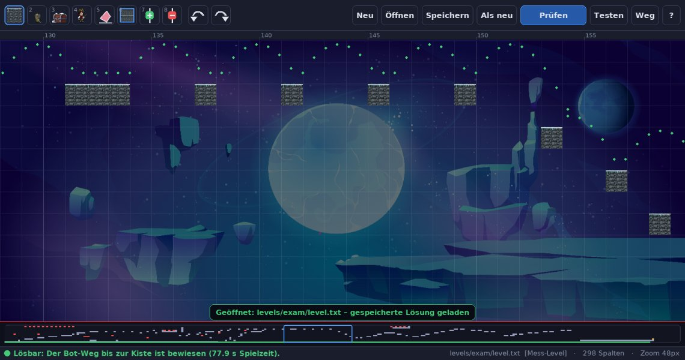

# Level und Level-Editor

[← zurück zur README](../README.md)

## Das Level-Format

Ein Level ist eine Textdatei mit 13 Zeilen; jedes Zeichen ist eine Kachel von 60 × 60 Pixeln.

| Zeichen | Bedeutung |
|---|---|
| `B` | Block |
| `E` | Gegner (läuft los, sobald er ins Bild kommt) |
| `C` | Kiste = Ziel (mehrere erlaubt, jede ist ein Ziel) |
| `P` | Startpunkt (optional, sonst Spalte 2 oben) |
| Leerzeichen | Luft (unten offen = Grube) |

| Ordner | Inhalt |
|---|---|
| `levels/exam/` | **Prüfungslevel**: das Original-Level von 2023 (`level.txt`) und eine entschärfte Fassung. Der Bot trainiert **nie** darauf. |
| `levels/exam2/` | zweite, lange geheime Prüfung |
| `levels/test_serie/` | 6 schwere handgebaute Test-Level, nie trainiert, mit geprüfter Lösung |
| `levels/phase1/`, `phase2/`, `handmade8–10/` | handgebaute Trainings- und Messlevel |
| `levels/showcase/` | feste Level für Videos |
| `levels/validierung/`, `levels/probes/` | eingefrorene Validierungs- und Fähigkeitsproben (JSON) |
| `levels/eigene/` | im Editor gebaute Level, kein Trainingsordner |

Neben einem Level kann `<name>.loesung.json` liegen: eine vom Löser gefundene, nachspielbare Aktionsliste. Sie gilt
als Beweis, dass das Level lösbar ist, und liefert die Bot-Zeit für die Sterne.

## Der Editor

```
python leveleditor.py                                   # neues Level (oder im Hauptmenü der App)
python leveleditor.py levels/phase1/p1_luecken_01.txt   # vorhandenes Level umbauen
```



- **Malen mit der Maus:**
  - Werkzeuge oben anklicken oder mit den Tasten 1–8 wählen: Block, Gegner, Kiste, Start, Radierer, Rechteck,
    Spalte einfügen, Spalte löschen.
  - Linke Maustaste malt (gedrückt ziehen), rechte radiert, Umschalt+Ziehen zieht ein Rechteck.
  - Wer rechts über das Level-Ende hinaus malt, verlängert das Level.
- **Navigieren:** Mausrad scrollt, Strg+Mausrad zoomt, mittlere Maustaste verschiebt die Ansicht, ein Klick in die
  Übersicht unten springt dorthin.
- **Tasten:** Strg+Z / Strg+Y für Rückgängig und Wiederholen, F1 zeigt alle Tasten.
- **Testspielen (T)** und **bewiesenen Weg abspielen (L)**; Esc führt zurück in den Editor.

### Prüfen: der „bewiesene Weg“

Die Taste P startet im Hintergrund eine Suche mit dem echten Löser und den Aktionen des Bots. Währenddessen kannst
du weiterbauen.

- **Grün:** Der Weg bis zur Kiste ist bewiesen und als Punktspur eingezeichnet.
- **Gelb:** Bewiesen bis Spalte X, danach hast du etwas geändert, das den Weg betrifft.
  - „Weiterprüfen“ setzt dort an (etwa 1 s davor), statt von vorn zu suchen.
  - Ob eine Änderung den Weg betrifft, prüft der Editor, indem er den Weg auf dem geänderten Level nachspielt und
    jeden Zustand vergleicht: Spieler, wache Gegner, Schüsse. Ein Block im Himmel kürzt nichts, ein Block, der
    einen Gegner umlenkt, schon.
- **Rot:** Ab der markierten Stelle wurde kein Weg gefunden.
  - Ehrlich gesagt kann das auch am Suchbudget liegen: Lange, verschlungene Level findet der Löser von Grund auf
    nicht immer, das Prüfungslevel zum Beispiel nicht.
  - Ein zweites Prüfen ohne Änderung sucht mit doppeltem Budget.

Nur ein gefundener Weg ist ein Beweis. „Kein Weg gefunden“ heißt nicht „unmöglich“.

### Speichern

- **Strg+S** aktualisiert die geöffnete Datei. Unveränderte Zeilen bleiben Byte für Byte gleich, damit Git-Diffs
  klein bleiben.
- **Strg+Umschalt+S** speichert als neues Level, standardmäßig in `levels/eigene/`.
- Ist der Weg bewiesen, wird `<name>.loesung.json` mitgespeichert. Eine nicht mehr passende Lösung bietet der
  Editor zum Entfernen an.
- **Mess-Level** (`levels/exam*`, `validierung`, `test_serie`) lassen sich öffnen und umbauen, aber nur als neues
  Level speichern. So bleiben Prüfung und Vergleichsreihen unverändert.

## Werkzeuge auf der Kommandozeile

```
python -m jumpnrun.levelgen.solver mein_level.txt          # ist das Level für den Bot schaffbar?
python -m jumpnrun.levelgen.solver mein_level.txt --map    # wo kann man überall stehen?
python -m jumpnrun.levelgen.solver mein_level.txt --video weg.mp4   # gefundenen Weg als Video
python -m jumpnrun.levelgen.generator --tier 4 --seed 7 --out mein_level.txt   # Level erzeugen (Stufe 0–13)
```
