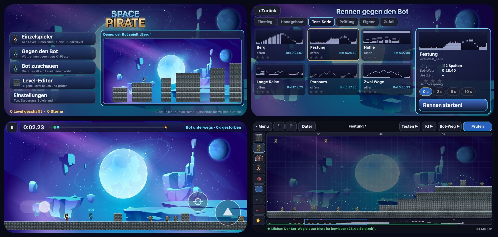
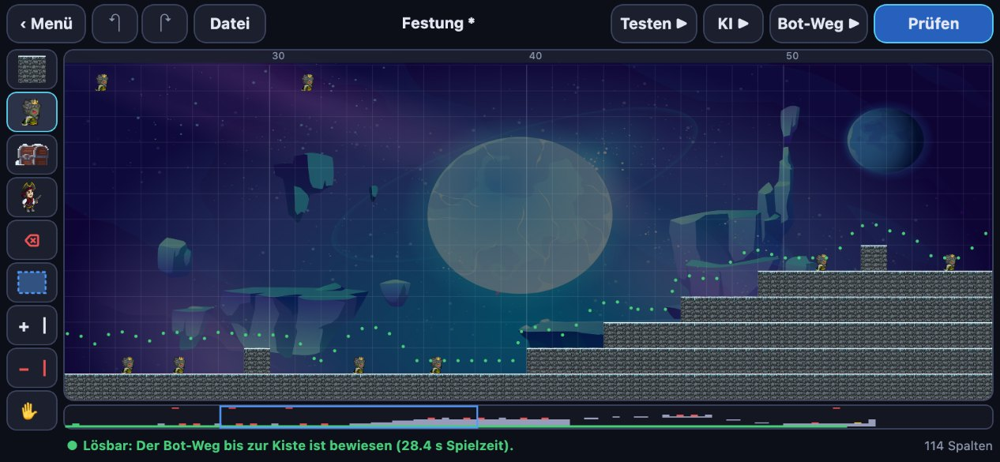

# Space Pirate auf dem iPhone

[← zurück zur Übersicht](README.md)

Die Handy-Version ist eine **Web-App (PWA)**. Sie läuft in Safari und kann per „Zum Home-Bildschirm“ als App-Icon
installiert werden. Danach startet sie im Vollbild und funktioniert offline. Der **Bot rechnet direkt auf dem
Handy**, es gibt keinen Server und keine Internetverbindung während des Spielens. Einen App Store, ein
Entwicklerkonto oder Xcode braucht es nicht.



Der Code liegt vollständig in [`mobile/`](../mobile/). Er ist eine eigenständige TypeScript-Portierung, die
nichts am Desktop-Paket `jumpnrun/` ändert.

## Installieren (einmalig)

1. Auf dem iPhone in **Safari** die Adresse öffnen: <https://leonvdetten.github.io/2D_JumpNRun/>
2. Unten auf **Teilen** (Quadrat mit Pfeil) tippen und **„Zum Home-Bildschirm“** wählen.
3. Space Pirate über das neue Icon starten. Das Handy quer halten.

Updates kommen automatisch. Die App lädt eine neue Version im Hintergrund, solange sie offen ist (alle 30 Minuten
und bei jedem Start). Sie lädt aber nur im Hauptmenü neu, nie mitten in einem Lauf. Ohne Netz läuft die zuletzt
geladene Version weiter.

## Steuerung

| Wo | Was |
|---|---|
| linke Bildschirmhälfte | **Laufen**: Finger aufsetzen und nach links oder rechts schieben (schwebender Stick, der Mittelpunkt ist dort, wo der Finger landet) |
| rechts, große Taste ▲ | **Springen** (gedrückt halten springt bei jeder Landung erneut, wie die Taste am Desktop) |
| rechts, Fadenkreuz | **Schießen** |
| oben links II | Pause |

Mit einer Bluetooth-Tastatur gelten die Desktop-Tasten (A/D, W/Leertaste, Enter, Esc). Tastengröße und Deckkraft
lassen sich in den Einstellungen anpassen.

**Leistungsanzeige** (Einstellungen): Unten erscheinen die Bildrate, der längste Frame der letzten Sekunde, die
Rechenzeit des Bots pro Entscheidung und die Bildschirmgröße. Damit lässt sich auf dem Handy messen, ob alles
flüssig läuft. Ziel sind 60 fps (120 auf ProMotion-Displays) und Bot-Zeiten von wenigen Millisekunden.

## Was die App kann

- **Einzelspieler** mit allen 57 Leveln in den Reitern Einstieg, Handgebaut, Test-Serie und Prüfung, dazu eigene
  Level und **Zufallslevel**. Es gibt 14 Stufen, und ein Seed ergibt dasselbe Level wie am Desktop.
- Bestzeiten, 1–3 Sterne und **Bestzeit-Geist** wie am Desktop.
- **Gegen den Bot**: Wettrennen mit Vorsprung 0, 2, 5 oder 10 s.
- **Bot zuschauen** (neu): Die KI spielt ein Level deiner Wahl in Dauerschleife, in 1×, 2× oder 4× Tempo, mit
  Zählern für Versuche und Siege.
- Musik und Effekte, synthetisiert wie am Desktop.
- **Spielstand sichern und laden** (Einstellungen): Die Datei hat das Format der Desktop-`save.json`. Ein Spielstand
  vom Mac (`~/.space_pirate/save.json`) lässt sich also aufs Handy holen und umgekehrt. Beim Laden werden beide
  Stände zusammengeführt, und je Level gilt der bessere.
- **Level-Editor** mit Prüfen durch den Bot (siehe unten). Eigene Level erscheinen im Reiter „Eigene“.

## Der Level-Editor auf dem Handy



| Bedienung | Was passiert |
|---|---|
| Werkzeugleiste links | Block, Gegner, Kiste, Start, Radierer, Rechteck, Spalte +, Spalte −, Verschieben |
| ein Finger | malt mit dem Werkzeug (wischen malt durchgehend); Rechteck: aufziehen, nochmal aufs Werkzeug tippen schaltet auf „leeren“ |
| zwei Finger | verschieben und zoomen (ein angefangener Strich wird dabei zurückgenommen) |
| Übersicht unten | tippen oder ziehen springt an die Stelle |
| ↶ ↷ | rückgängig, wiederholen |
| **Prüfen** | sucht im Hintergrund (Web Worker) einen echten Bot-Weg, während du weiterbaust. Grün = bewiesen, gelb = bis Spalte X bewiesen und danach geändert („Weiterprüfen“ setzt dort an), rot = kein Weg gefunden („Nochmal“ sucht mit doppeltem Budget) |
| Testen ▶ · KI ▶ · Bot-Weg ▶ | selbst spielen · den trainierten Bot spielen lassen · den bewiesenen Weg abspielen; jeweils zurück in den Editor |
| Datei | neu, öffnen (eigene Level oder ein mitgeliefertes als Vorlage), speichern, speichern unter, als `.txt` teilen, `.txt` importieren, löschen |

Gespeicherte Level landen im Spielstand unter „Eigene“. Ein bewiesener Weg wird mitgespeichert und dient dann als
Richtzeit für die Sterne. Der aktuelle Entwurf wird laufend gesichert, auch wenn iOS die App im Hintergrund beendet.
Mit „Als .txt teilen“ und „.txt importieren“ wandern Level zwischen Handy und Desktop-Editor
(`levels/eigene/`). Die Prüf-Logik ist eine Portierung von `jumpnrun/editor/proof.py` und
`jumpnrun/levelgen/solver.py`: dasselbe Budget (120.000 Knoten, beim Wiederholen verdoppelt) und dieselben Ergebnisse
auf den Testleveln. In JavaScript ist sie deutlich schneller als in Python.

## Wie die Portierung abgesichert ist

Spielkern, Zufall, Generator, Weg-Karte und Bot sind Zeile für Zeile aus Python übertragen. Vergleichstests mit
Vitest prüfen sie gegen Goldwerte, die aus dem Python-Code erzeugt werden (`mobile/tools/make_fixtures.py`,
`mobile/tools/export_bot.py --fixtures`):

| Test | Ergebnis |
|---|---|
| Alle gespeicherten Bot-Lösungen (`*.loesung.json`) nachspielen | identische Zustände, jede gewinnt |
| Zufällige Eingaben auf 17 Leveln, Frame für Frame | identisch |
| Pythons `random.Random` (Mersenne Twister mit String-Seed, `randint`, `choice(s)`, `sample`) | bitgenau |
| Generator: 400 Level als Text plus 4.200 weitere Seeds über den Level-Schlüssel | alle identisch |
| Offline: Server gestoppt, App neu geladen | startet aus dem Cache bis ins Menü, Bot und Editor-Prüfung verfügbar |
| Weg-Karte und Richtzeiten auf allen mitgelieferten und 28 erzeugten Leveln | identisch |
| Bot-Beobachtung (Gitter, Übersichtskarte, Vektor) bei 1.200 Entscheidungen | bitgenau |
| Bot-Netz (Logits gegenüber PyTorch) | Abweichung < 0,0001 |
| Bot auf dem Prüfungslevel, 64 Versuche bei T = 0,3 (`npm run test:bot`) | **62/64 = 97 %** (Python: 98 %) |
| Löser und „Prüfen“: Berg, Parcours, Zickzack werden mit dem Grundbudget bewiesen, Wege spielen sich bis zur Kiste nach | wie in Python |

Eine bekannte Feinheit: `gammavariate` braucht einen Logarithmus. Die Mac-Bibliothek rundet ihn in etwa 0,07 % der
Fälle anders als mathematisch exakt. Die App rechnet korrekt gerundet, sodass in seltenen Fällen ein Stilgewicht im
letzten Bit abweicht (10⁻¹⁶). In allen 4.600 verglichenen Leveln hatte das keine Auswirkung.

## Aufbau

```
mobile/
  src/core/       Spielkern (Level, Figuren, Simulation), 1:1 aus jumpnrun/core
  src/levelgen/   Python-Zufall, Generator, Weg-Karte, Löser
  src/bot/        Beobachtung (aus jumpnrun/rl/env.py), Netz-Vorwärtsrechnung, Bot-Gegner
  src/editor/     Editor-Modell, bewiesener Weg, Prüf-Worker (aus jumpnrun/editor/)
  src/render/     Sprite-Atlas, Renderer mit weicher Zwischenbild-Berechnung (Spiel 30 Hz, Bild 60/120 Hz)
  src/audio/      Klang-Synthese (aus jumpnrun/app/audio.py) über WebAudio
  src/input/      Touch-Steuerung und Tastatur
  src/app/        App-Rahmen, Szenen, Spielstand, Levelliste
  src/ui/         Zeichenhilfen, Bedienelemente, Hintergrund, Vorschaubilder
  src/platform/   Speicher, Dateien, Service Worker (austauschbar für eine spätere native Hülle)
  public/         erzeugte Daten: Sprite-Atlas, Hintergrund, Icons, levels.json, Bot-Gewichte
  tools/          Python-Exportwerkzeuge (lesen jumpnrun/ nur)
  tests/          Vergleichstests gegen Python · tests-slow/ Bot-Erfolgsquote
```

Die Spielwelt behält die Maße des Desktops: 13 Reihen à 60 Einheiten, 800 Einheiten hoch. Sie wird auf die
Bildschirmhöhe skaliert. Breitere Handys zeigen nach vorn genauso viel wie der Desktop (1.220 Einheiten), der
zusätzliche Platz liegt hinter dem Piraten. So verdeckt der Daumen auf dem Lauf-Stick die Figur nicht. Menüs und HUD
sind in „UI-Einheiten“ gebaut, 390 hoch, was etwa den Punkten eines iPhones entspricht. So sind Schrift und Tasten
auf jedem Gerät gleich groß.

## Entwickeln

```bash
cd mobile
npm install
npm run dev          # Entwicklungsserver, auch im WLAN erreichbar (http://<Mac-IP>:5173)
npm test             # Vergleichstests (~10 s)
npm run test:bot     # Bot-Erfolgsquote auf dem Prüfungslevel (BOT_EPISODES=64, einige Minuten)
npm run build        # fertige App nach mobile/dist
```

`http://localhost:5173/?start=editor` öffnet direkt den Editor.

**Screenshots für die Doku:** Der Entwicklungsserver nimmt per `POST /__screenshot?name=x` ein JPEG an und legt es
als `docs/medien/mobile_x.jpg` ab, etwa aus der Browser-Konsole mit `canvas.toBlob(...)` und `fetch(...)`. Die
Collage `mobile_collage.jpg` setzt sich aus Menü, Levelauswahl, Rennen und Editor zusammen, jeweils bei
844 × 390 Punkten (iPhone 15 quer).

Daten neu erzeugen, wenn sich Level, Grafiken oder der Bot am Desktop ändern (aus dem Projektordner,
mit der Python-Umgebung des Projekts):

```bash
.venv/bin/python mobile/tools/export_levels.py      # levels.json + Sprungkatalog
.venv/bin/python mobile/tools/export_assets.py      # Sprite-Atlas, Hintergrund, Icons
.venv/bin/python mobile/tools/export_bot.py --fixtures   # Bot-Gewichte + Vergleichsdaten
.venv/bin/python mobile/tools/make_fixtures.py      # Goldwerte für die Vergleichstests
```

**Veröffentlichen:** Jeder Push auf `mobile` oder `main`, der `mobile/` ändert, baut die App per GitHub Action
(`.github/workflows/mobile-pages.yml`), führt die Tests aus und legt das Ergebnis auf den Branch `gh-pages`.
Einmalig muss dafür in GitHub unter *Settings → Pages* die Quelle „Deploy from a branch“, `gh-pages`, `/ (root)`
gewählt werden.

## Später: als native App

Die App ist so gebaut, dass sie sich mit [Capacitor](https://capacitorjs.com) in eine echte iOS-App verpacken
lässt: relative Pfade, Speichern und Dateien hinter `src/platform/`, und der Service Worker ist optional. Dafür
braucht es Xcode. Mit einer kostenlosen Apple-ID muss die App alle 7 Tage vom Mac neu aufgespielt werden.
