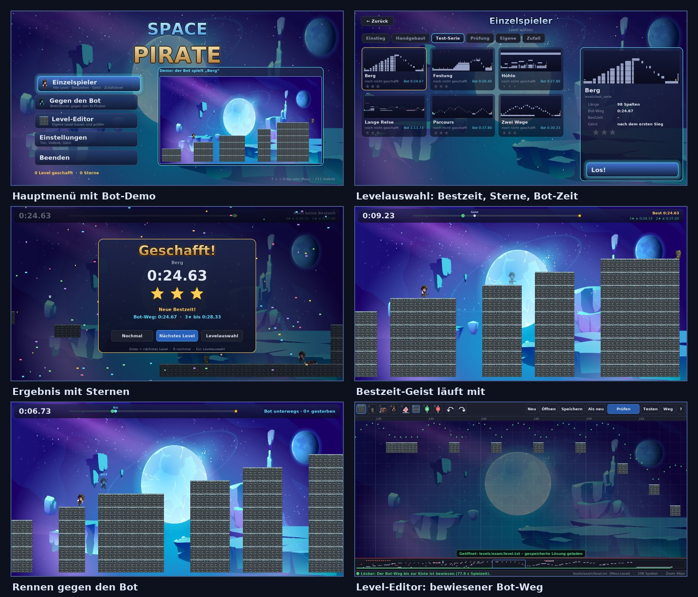

# Spielen

[← zurück zur README](../README.md)

```
python spacepirate.py                            # die App: Ladescreen, Menü, alle Modi
python game.py                                   # dasselbe
python game.py levels/phase1/p1_luecken_01.txt   # ein Level direkt, ohne Menü
python spacepirate.py --no-bot                   # App ohne den Bot (startet ohne PyTorch schneller)
```



## Spielidee

Du steuerst einen Weltraumpiraten durch ein Level aus Blöcken, Lücken und Gegnern. Gegner besiegst du mit einem
Sprung auf den Kopf oder mit dem Revolver. Ziel ist die Schatzkiste am Ende des Levels. Gemessen wird die Zeit bis
zur Kiste.

| Taste | Aktion |
|---|---|
| `A` / `D` oder Pfeiltasten | laufen |
| `W`, Leertaste oder Pfeil hoch | springen |
| Enter | schießen (1 s Nachladezeit) |
| `R` | Neustart |
| Esc / `P` | Pause; im Menü: zurück |
| F11 | Vollbild |

## Die Modi im Hauptmenü

### Einzelspieler
- **Levelauswahl mit Reitern:**
  - Einstieg: `phase1`, `phase2`, `showcase`
  - Handgebaut: `handmade8–10`
  - Test-Serie
  - Prüfung: das Original-Level von 2023, die entschärfte Fassung, Prüfung 2
  - Eigene: `levels/eigene`, die Level aus dem Editor
- **Zufallslevel:** Sie kommen aus dem Generator, mit dem der Bot trainiert hat. Es gibt 14 Stufen von
  „Spaziergang“ bis „Kanäle & Gabeln“, und jedes Level ist lösbar gebaut. Der Seed wird angezeigt, damit sich ein
  Level wiederholen lässt.
- **Sterne:**
  - Die Messlatte ist die Zeit des bewiesenen Bot-Wegs, gespeichert als `<level>.loesung.json`.
  - 3 Sterne gibt es bis höchstens 15 % langsamer, 2 Sterne bis 50 % langsamer, 1 Stern für geschafft.
  - Hat ein Level keinen gespeicherten Weg, gilt eine geschätzte **Richtzeit**: die Weglänge laut Weg-Karte bei
    Vollgas.
- **Bestzeit-Geist:** Ab dem ersten Sieg läuft dein bester Lauf halbtransparent mit. Er wird aus den gespeicherten
  Tasteneingaben exakt nachgespielt. Das geht, weil die Simulation deterministisch ist: gleiche Eingaben ergeben
  immer dasselbe Spiel.

### Gegen den Bot
- Ein Wettrennen gegen `models/space_pirate_bot.zip`. Der Bot läuft als halbtransparenter, cyanfarbener Pirat im
  selben Level. Ist er außer Sicht, zeigt ein Pfeil am Bildrand, wo er ist und wie viele Spalten Abstand ihr habt.
- Der Bot läuft immer Vollgas und springt präzise. Deshalb ist der **Vorsprung** (0, 2, 5 oder 10 s) der
  Schwierigkeitsregler.
- Wer stirbt, beginnt nach 1 s am Start neu; das gilt für beide. Wer zuerst die Kiste erreicht, gewinnt. Ist der
  Bot im Ziel, endet das Rennen 2 s später.
- Dafür braucht es PyTorch und stable-baselines3. Ohne sie ist der Modus ausgegraut, und das Menü zeigt einen
  Hinweis.

### Level-Editor
Er ist direkt aus dem Menü erreichbar. Bedienung und Prüflogik stehen in [level_editor.md](level_editor.md).

### Einstellungen
Vollbild, Musik- und Effekt-Lautstärke, Geist an/aus, Standard-Vorsprung. Musik und Effekte werden beim Start mit
numpy **synthetisiert** (`jumpnrun/app/audio.py`), es gibt keine Audiodateien. Ohne Audiogerät bleibt das Spiel
stumm.

## Spielstand

`~/.space_pirate/save.json` speichert Einstellungen, Bestzeiten, Sterne, die Eingaben des Bestlaufs und die
Rennbilanz gegen den Bot. Den Ordner kannst du mit der Umgebungsvariablen `SPACE_PIRATE_HOME` ändern.

Ein Level wird am Hash seines Textes erkannt: Änderst du es im Editor, beginnt dafür eine neue Bestenliste.

## Technik in Kürze

- **Feste Bildgröße:** Die App zeichnet immer auf 1520 × 800 Pixel. Fenster und Vollbild skalieren dieses Bild
  (`pygame.SCALED`).
- **Szenen:** Ladescreen, Menü, Levelauswahl, Spiel, Pause, Ergebnis, Einstellungen und Editor sind eigene
  Szenen in `jumpnrun/app/scenes.py`, die auf einem Stapel liegen.
- **Spieltakt:** Die Spiellogik läuft mit festen 30 Frames pro Sekunde, Menüs und Animationen mit der
  Bildwiederholrate.
- **Der Bot im Rennen:** Er spielt in einer eigenen Simulation (`jumpnrun/app/bot.py`) und trifft alle 2 Frames
  eine Entscheidung, etwa 3 ms Rechenzeit je Entscheidung auf der CPU.
